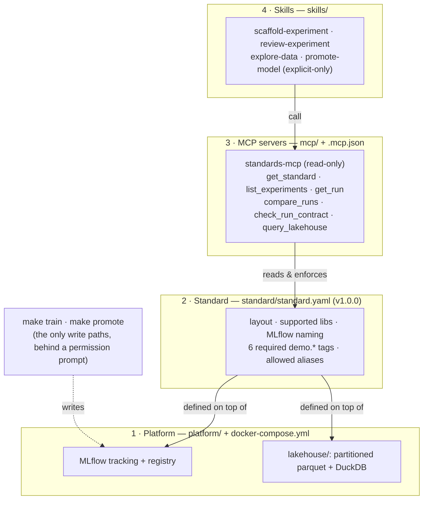

# ai-native-mle-starter

A small, runnable repo that shows an **AI-native ML engineering** workflow with
Claude Code: **skills** tell the agent *how* to scaffold, run and review experiments,
using **read-only MCP tools** that expose a **versioned ML standard**, on top of a
local **platform** (MLflow + parquet queried with DuckDB).

> **An MCP cannot be better than the standard it exposes.**
> "Compare experiments" means nothing if runs follow no convention. So the standard
> comes first, the MCP exposes it, and the skills encode the procedure on top.

Everything runs on a laptop with Docker. All data is synthetic.

## The four layers

Each layer is a folder:



| Layer | Folder | What it gives the agent |
|---|---|---|
| 1. Platform | `platform/`, `docker-compose.yml`, `lakehouse/` | Where work lives: MLflow (tracking + registry) and parquet (a local stand-in for a lakehouse). |
| 2. Standard | `standard/standard.yaml`, `model_versions/` | What "correct" means: folder layout, scikit-learn/LightGBM only, run naming, a tag contract that training **checks** (the run fails if the tags are missing). |
| 3. MCP | `mcp/`, `.mcp.json` | Evidence: read-only tools over the standard, MLflow runs and the data. |
| 4. Skills | `skills/` → `.claude/skills/`, `.agents/skills/` | Procedure: how to scaffold, review, explore and (only when asked) promote. |

## Prerequisites

- **Docker** with Compose v2 (Docker Desktop on macOS arm64/x86 and Windows; Docker Engine on Linux).
  **Windows:** run everything inside **WSL2** (clone the repo in the Linux filesystem, e.g. `~/src`, not `/mnt/c`).
- **Claude Code** CLI: <https://code.claude.com/docs/en/setup>
- `make`, `bash`, `curl` (present on macOS, Linux and WSL2).
- Optional: **uv** (to run `scripts/verify_mcp.py` from the host), **Node.js** (only for the eval module).

About 2 GB of disk for images (app ≈ 0.8 GB, MLflow ≈ 1.0 GB). Ports 5050 and 8765 on localhost.

## Quickstart

```bash
git clone <this-repo> ai-native-mle-starter && cd ai-native-mle-starter
make up        # builds the app image the first time, starts MLflow + standards-mcp
make seed      # synthetic lakehouse + 3 MLflow runs (one deliberately breaks the contract)
make doctor    # checks Docker, ports, MLflow, the MCP endpoint and the Claude Code CLI
claude         # trust the folder, approve the project MCP server "standards-mcp"
```

Then ask: *"Review the v1 experiments. Is anything ready to promote?"*

**Presenting this live?** Follow [`DEMO.md`](DEMO.md): a 15-minute run sheet with the exact
prompts, what the audience should see, and a fallback command for every step.
`make demo-reset` gives you a clean slate between rehearsals.

With images already built, `make up && make seed` takes well under a minute (about 25 s
on an M-series laptop). The first `make up` downloads and builds images. **Do it before
the venue:** after `make up`, nothing in the stack needs the internet; only Claude Code does.

MLflow UI: <http://localhost:5050>.

## Repo map

```
.
├── CLAUDE.md                 project memory for Claude Code: the standard in 5 lines + golden rules
├── .claude/settings.json     permissions: allow read-only MCP tools + make targets; deny edits to standard/lakehouse
├── .mcp.json                 project-scoped MCP config (standards-mcp over HTTP)
├── docker-compose.yml        mlflow · standards-mcp · trainer (jobs) · test · gateway (optional profile)
├── Makefile                  up · down · seed · train · scaffold · promote · test · doctor · reset
├── platform/                 LAYER 1: Dockerfile + pinned requirements (uv-compiled locks)
├── lakehouse/                LAYER 1: generated parquet (git-ignored) + README with the schema
├── standard/standard.yaml    LAYER 2: the versioned standard
├── model_versions/           LAYER 2: _TEMPLATE/ + v1/{baseline, lgbm_monotonic, lgbm_missing_tags}
├── mcp/standards_mcp/        LAYER 3: FastMCP server (6 read-only tools)
├── skills/                   LAYER 4: one source of truth for skills (Agent Skills format)
├── src/mle_starter/          shared library: standard checks, datagen, SQL guard, train, promote, scaffold, seed
├── scripts/                  install-skills.sh · doctor.sh · validate_skills.py · verify_mcp.py
├── evals/                    optional: promptfoo baseline-vs-skill eval through a LiteLLM gateway
├── tests/                    pytest: contract, MCP tools (via MCP client), SQL guard, seed, skills
├── DEMO.md                   live run sheet for the talk
└── EXERCISES.md              5 hands-on exercises
```

## How the pieces enforce each other

- **Check, don't trust.** `make train` logs the tags, then reads the run back from the
  MLflow server and checks the contract. Missing or invalid tags → the run is marked
  `FAILED`, no model is registered, and the command exits non-zero.
- **Read-only by default.** No MCP tool writes. Writes go through `make train` and
  `make promote`; `make promote` is an `ask` rule in `.claude/settings.json`, so Claude Code
  always shows a permission prompt, and the script itself refuses runs that fail the contract
  and does a dry run unless `CONFIRM=yes`.
- **Invocation governance.** `promote-model` has `disable-model-invocation: true`: Claude
  never picks it on its own; you type `/promote-model`.
- **One source, many clients.** Skills live once in `skills/`; `make skills`
  (`scripts/install-skills.sh`, run by `make up`) symlinks them into `.claude/skills/` (Claude Code)
  and `.agents/skills/` (Codex). Run it as often as you like.
- **Guarded data access.** `query_lakehouse` allows exactly one `SELECT`, blocks
  `DROP`/`INSERT`/`COPY`/`ATTACH`/…, sandboxes DuckDB to the lakehouse folder and caps rows.
  Why this instead of the community DuckDB MCP: see [`mcp/README.md`](mcp/README.md).

## Verify the MCP servers are connected

```bash
make doctor          # includes a real MCP initialize request to http://localhost:8765/mcp
claude mcp list      # from the repo root → standards-mcp: http://localhost:8765/mcp (HTTP) - ✔ Connected
```

Inside Claude Code, run `/mcp` to see the server and its six tools.

`claude mcp list` shows **⏸ Pending approval** until you start `claude` in the repo once,
trust the folder and approve `standards-mcp`. That approval step is Claude Code's protection
against project files that add MCP servers; `enabledMcpjsonServers` in `.claude/settings.json`
only takes effect once the folder is trusted.

To call every tool from a script (same HTTP endpoint Claude uses):
`uv run --with mcp==1.30.0 scripts/verify_mcp.py`.

## Everyday commands

```bash
make scaffold MV=v1 EXP=lgbm_shallow             # new experiment from _TEMPLATE
make train EXP=model_versions/v1/lgbm_shallow    # the only way runs get written
make promote RUN=<run_id> ALIAS=challenger       # dry run; add CONFIRM=yes to apply
make test                                        # ruff + skill validation + pytest, in Docker
make down                                        # stop (keeps MLflow data)
make reset                                       # DESTRUCTIVE: delete MLflow volumes and generated data
make demo-reset                                  # DESTRUCTIVE: reset + drop rehearsal experiments + up + seed + doctor
```

## Optional modules

- **Skill evals** (`evals/`): promptfoo runs `review-experiment` without and with the skill on a
  pinned, dated model through a LiteLLM gateway, and reports the delta. Needs your own API key;
  see [`evals/README.md`](evals/README.md). It never blocks the core demo.
- **Memory MCP**: the reference `memory` server, see [`mcp/README.md`](mcp/README.md#optional-the-reference-memory-server).

## Troubleshooting

| Symptom | Fix |
|---|---|
| `make doctor`: port 5050/8765 in use | Something else holds the port. `MLFLOW_PORT=5051 make up`. For the MCP port, also change the URL in `.mcp.json`. On macOS, port 5000 is taken by AirPlay, which is why MLflow is on 5050. |
| `claude mcp list` → Pending approval | Start `claude` in the repo root, trust the folder, approve `standards-mcp`. Reset choices: `claude mcp reset-project-choices`. |
| `claude mcp list` → Failed to connect | `make up`, then `docker compose logs standards-mcp`. The server answers only on `localhost`/`127.0.0.1` (DNS-rebinding protection). |
| MCP tool returns `mlflow_error` | MLflow is down or still starting: `make up` waits for health; check `docker compose logs mlflow`. |
| `run_not_found` / empty experiments | `make seed`. |
| `make train` → `REJECTED before training` | The folder or config breaks the standard; the message lists every problem. |
| `make train` → `RUN FAILED … tag contract` | Working as designed: the run did not log the contract. Fix the training code/config and train again. |
| Files in `lakehouse/` owned by root (Linux) | The Makefile runs containers as your UID. If you ran `docker compose` directly, prefix `HOST_UID=$(id -u) HOST_GID=$(id -g)`. |
| Windows | Use WSL2 with the repo on the Linux filesystem; Docker Desktop with the WSL2 backend. Native PowerShell is not supported. |
| Want to run tests outside Docker on macOS | LightGBM needs OpenMP: `brew install libomp`, then `uv venv -p 3.12 && uv pip install --no-deps -r platform/requirements/dev.txt && .venv/bin/pytest`. |
| Start over | `make reset && make up && make seed`. |

## Versions

Pinned: MLflow `v3.17.2` image and client, `mcp 1.30.0`, scikit-learn `1.9.1`, LightGBM `4.7.0`,
DuckDB `1.5.6`, pandas `3.0.6`, `python:3.12.16-slim-bookworm`, LiteLLM `v1.106.6`, promptfoo `0.125.1`.
Full locks: `platform/requirements/app.txt` and `dev.txt`.

## License

MIT. See [LICENSE](LICENSE). Contributions: [CONTRIBUTING.md](CONTRIBUTING.md).
