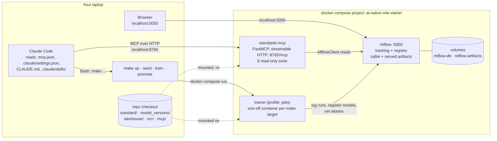
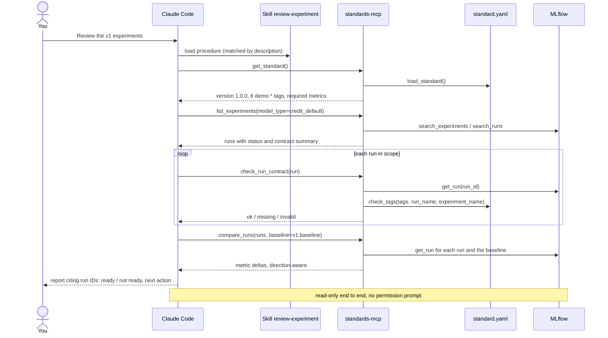
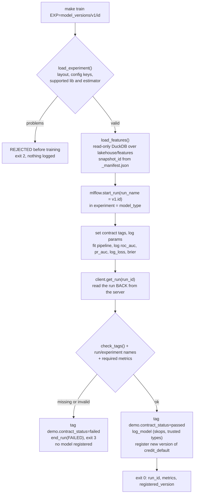
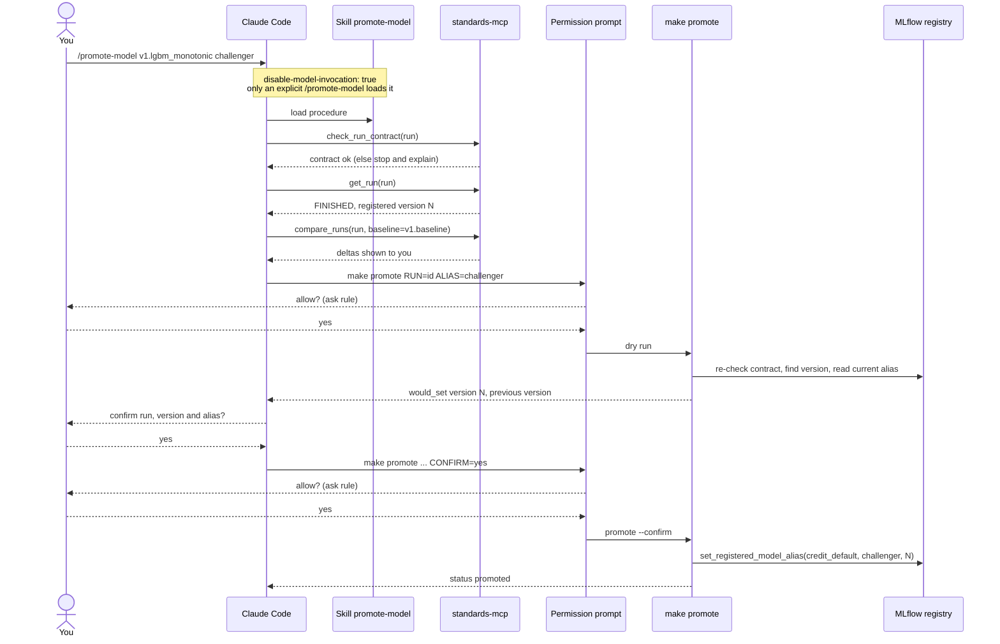
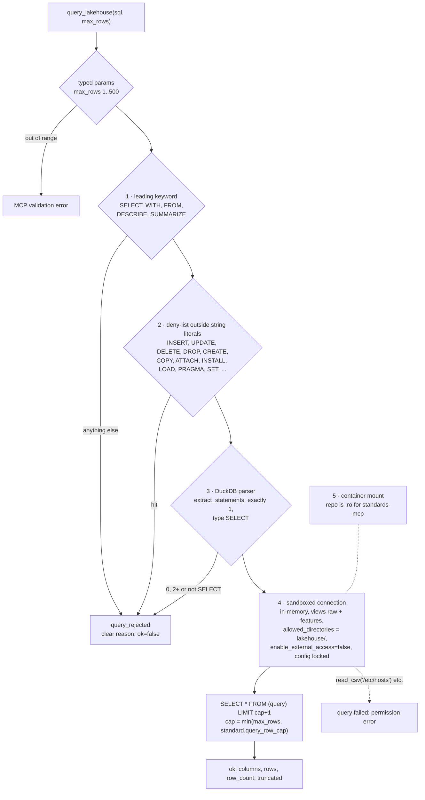
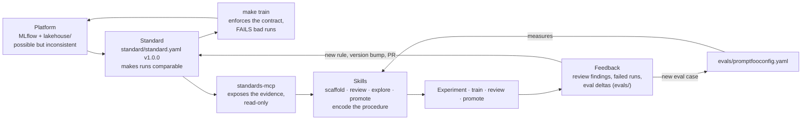

# Architecture: how the pieces work together

The [README](../README.md#the-four-layers) shows the four layers as folders. This page
shows them **at run time**: what calls what, where the checks happen, and which paths can
write. Every name below (tools, functions, make targets) exists in the code.

1. [Runtime topology](#1-runtime-topology): containers, ports, mounts
2. [Reviewing an experiment](#2-reviewing-an-experiment-read-only): the read-only path
3. [Training a run](#3-training-a-run-check-dont-trust): check, don't trust
4. [Promoting a model](#4-promoting-a-model-explicit-only-gated): explicit-only, gated
5. [Read-only SQL](#5-read-only-sql-over-the-lakehouse): the guards behind `query_lakehouse`
6. [The loop](#6-the-loop-standard--mcp--skills--feedback): standard → MCP → skills → feedback

---

## 1. Runtime topology

Everything binds to `127.0.0.1`. The MCP server sees the repo **read-only**; only the
one-off `trainer` job mounts it read-write. After `make up`, nothing here needs the internet.

| Piece | Image | Writes? |
|---|---|---|
| `mlflow` | `ghcr.io/mlflow/mlflow:v3.17.2` | stores what it is sent |
| `standards-mcp` | `ai-native-mle-starter-app:local` | no: no write tools, repo mounted `:ro` |
| `trainer` | same app image | yes, and only through `make train` / `make promote` / `make seed` / `make scaffold` |

---

## 2. Reviewing an experiment (read-only)

Prompt: *"Review the v1 experiments. Is anything ready to promote?"* The
`review-experiment` skill turns that into a fixed procedure. Every tool is allow-listed in
`.claude/settings.json`, so no permission prompt appears, and nothing is written.

---

## 3. Training a run: check, don't trust

`make train EXP=model_versions/v1/<id>` → `python -m mle_starter.train`. The run is
accepted only after its tags are **read back from the server** and checked against the
contract. A run that "forgets" a tag is marked `FAILED` and registers nothing.

The seeded run `v1.lgbm_missing_tags` exercises the left branch on purpose: same model and
metrics as `v1.lgbm_monotonic`, but its config's `demo_fault` drops `demo.data_snapshot` and
sets `demo.standard_version=0.9.0`.

---

## 4. Promoting a model (explicit-only, gated)

The only write the agent can trigger outside training. Four independent gates: the skill
is never auto-invoked, the script refuses runs that fail the contract, the default is a dry
run, and `make promote` is an `ask` rule, so Claude Code always shows a permission prompt.

---

## 5. Read-only SQL over the lakehouse

`query_lakehouse(sql, max_rows)` in `mcp/standards_mcp/server.py` calls
`mle_starter.lakehouse.run_query`. Each guard would stop a write on its own; together they
mean a single bug does not open a write path.

Tests in `tests/test_sql_guard.py` and `tests/test_mcp_tools.py` cover each guard,
including `DROP`, `INSERT`, `COPY`, `ATTACH`, multi-statement, comment-hidden and
file-access attempts.

---

## 6. The loop: standard → MCP → skills → feedback

Why the order matters: the MCP can only expose evidence the standard makes comparable,
and skills can only encode a procedure the tools support. Real failures flow back as
eval cases and standard changes, which ship like a product (version bump, tests, PR).

Where to go next: [`EXERCISES.md`](../EXERCISES.md) walks this loop yourself (add a tag →
bump the standard → new tool → new skill → new eval case).
